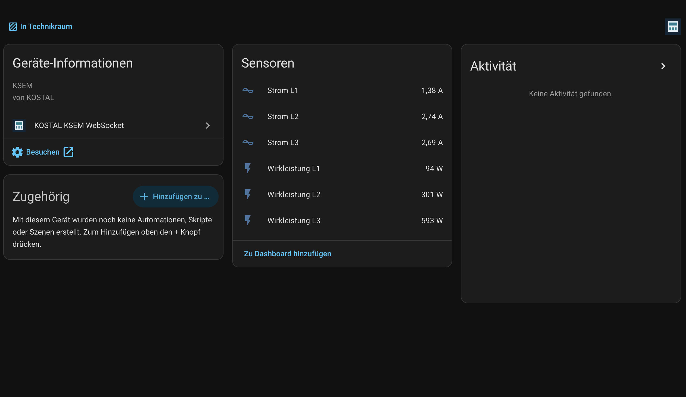

# KOSTAL KSEM WebSocket · v0.1.1

Inoffizielle Home-Assistant-Custom-Integration für den KOSTAL Smart Energy Meter.
Einrichtung über **Einstellungen → Geräte & Dienste → Integration hinzufügen →
KOSTAL KSEM WebSocket** mit IP/Hostname und Administratorpasswort.

**Local Push über WebSocket/Protobuf. Kein Modbus TCP, kein KSEM TCP-Slave.**
Die Integration aktiviert keine Geräteschnittstellen und schreibt keine KSEM-Einstellungen.
Sie meldet sich am Web-Login an und liest ausschließlich den Smart-Meter-Datenstrom.

## In Home Assistant

**Praxistest am 20. Oktober 2026 bestätigt:** Die Anmeldung über den Config Flow
war erfolgreich. Das KSEM-Gerät und alle sechs Entitäten erschienen sofort;
der Screenshot zeigt Strom L1/L2/L3 und Wirkleistung L1/L2/L3 mit Messwerten.

## Sechs Sensoren

| Entität | Einheit | Umrechnung |
| --- | --- | --- |
| Strom L1 | A | Rohwert / 1000 |
| Strom L2 | A | Rohwert / 1000 |
| Strom L3 | A | Rohwert / 1000 |
| Wirkleistung L1 | W | (Bezug − Einspeisung) / 1000 |
| Wirkleistung L2 | W | (Bezug − Einspeisung) / 1000 |
| Wirkleistung L3 | W | (Bezug − Einspeisung) / 1000 |

Positive Wirkleistung bedeutet Bezug, negative Einspeisung. Alle Sensoren verwenden
`measurement`; dies sind keine Energiezähler für kWh. Fehlende Messwerte werden nicht
als Null erfunden. Fehlt nur einer der beiden Leistungsrichtungswerte, wird er wie in
der funktionierenden Vorlage als Null interpretiert.

## Voraussetzungen und Stand

- Home Assistant Core ab 2025.6.0 als Zielversion; siehe `VALIDATION.md` für die tatsächlich ausgeführten Prüfungen.
- KSEM im lokalen Netzwerk, per HTTP-Port 80 von Home Assistant erreichbar.
- KSEM-Administratorpasswort; ein manuell angelegter API-Schlüssel ist nicht erforderlich.
- Ausgangsversion laut Nutzerrückmeldung mit KSEM-Firmware **2.7.2** funktionierend,
  einschließlich plausibler Werte aller sechs Sensoren. Andere Firmwarestände sind unbestätigt.
- Config Flow, Geräteanlage und sechs Entitäten wurden am 20. Oktober 2026 in einer
  echten Home-Assistant-/KSEM-Installation vom Nutzer bestätigt. Langzeitbetrieb,
  Wiederverbindung und Reauthentifizierung benötigen noch den Praxistest.
  Kein offizielles KOSTAL-Protokollversprechen.

## Installation

### Manuell

1. Den Ordner `custom_components/ksem_ws` vollständig in das gleichnamige Verzeichnis
   unter deiner Home-Assistant-Konfiguration kopieren.
2. Home Assistant vollständig neu starten.
3. Integration hinzufügen, IP-Adresse oder Hostname **ohne URL-Schema, Port und Pfad**
   sowie Administratorpasswort eingeben.
4. Die Einrichtung ist erst erfolgreich, wenn Anmeldung, WebSocket und ein gültiger
   Smart-Meter-Messdatensatz empfangen wurden. Danach erscheinen ein Gerät und sechs Entitäten.

### HACS Custom Repository

[Dieses Repository](https://github.com/soso1999/ha-kostal-ksem-websocket) in HACS unter benutzerdefinierte Repositories eintragen,
Typ **Integration** wählen, herunterladen und Home Assistant neu starten.
Danach wie oben einrichten. Das Projekt ist nicht als HACS-Standardrepository gelistet.
Die aktuelle HACS-Struktur ist gemäß [HACS-Dokumentation](https://www.hacs.xyz/docs/publish/integration/)
vorbereitet; eine HACS-Aufnahme/Live-Validierung ist damit nicht behauptet.

## Wechsel von der YAML-Testversion

1. Home-Assistant-Backup erstellen. Alte `custom_components/ksem_ws`-Dateien sichern.
2. Den alten `- platform: ksem_ws`-Block unter `sensor:` entfernen.
3. Neue Dateien einsetzen und neu starten; anschließend über die Oberfläche einrichten.
4. Den alten Passwort-Eintrag aus `secrets.yaml` nur entfernen, wenn er sonst unbenutzt ist.

Es gibt **keinen automatischen YAML-Import**. Die neue Version verwendet stabile IDs
auf Basis des Config Entry. Die alte Version verwendete Host-basierte IDs. Deshalb können
neue Entitäts-IDs entstehen; Dashboards/Automationen prüfen und verwaiste alte Entitäten
nach erfolgreichem Test entfernen. Ein Host wird nur einmal eingerichtet. IP und DNS-Alias
werden nicht als dasselbe physische Gerät erkannt. Für eine andere Adresse ist eine
Neueinrichtung erforderlich; die erneute Authentifizierung ändert nur das Passwort.

## Verbindung und Fehler

Die Integration holt vor jeder Verbindung einen neuen Token, öffnet
`/api/data-transfer/ws/protobuf/gdr/local/values/smart-meter` und sendet den Bearer-Token
als erste WebSocket-Textnachricht. Es folgt ausschließlich passives Lesen.
Wiederverbindung erfolgt mit 5 bis 60 Sekunden Wartezeit. Nach 30 Sekunden ohne
verwertbaren Messdatensatz werden die Sensoren nicht verfügbar und die Verbindung erneuert.
Bei expliziter Ablehnung der Zugangsdaten bietet Home Assistant erneute Authentifizierung an.
Wenn der WebSocket nach erfolgreichem Login sofort schließt, wird dies als Verbindungsfehler
behandelt, da daraus kein falsches Passwort sicher abgeleitet werden kann.

- **Anmeldung abgelehnt:** Administratorpasswort prüfen.
- **Keine Livewerte:** Erreichbarkeit, HTTP-Zugriff und Firmwarekompatibilität prüfen.
- **Nicht verfügbar:** Netzwerk/KSEM kontrollieren; Wiederverbindung läuft automatisch.

## Zugangsdaten

Das Passwort liegt in Home Assistants Config-Entry-Speicher und damit auch in dessen
Backups; es wird nicht separat durch diese Integration verschlüsselt. Tokens bleiben
nur im Arbeitsspeicher. Weder Passwort noch Token, HTTP-Antworten oder Rohdaten werden
von der Integration protokolliert. Der bestätigte Transport ist **HTTP/WS ohne TLS**;
Zugangsdaten nur im vertrauenswürdigen lokalen Netzwerk verwenden, nicht über das Internet.
Keine privaten Adressen, Passwörter oder Tokens sind Bestandteil dieses Pakets.

## Entwicklung und Veröffentlichung

Siehe `CONTRIBUTING.md`, `VALIDATION.md`, `PUBLISHING.md` und `RELEASE_v0.1.0.md`.
Repository: [soso1999/ha-kostal-ksem-websocket](https://github.com/soso1999/ha-kostal-ksem-websocket).

## Unterstützung ☕

Wenn dir diese Integration hilft, kannst du meine Arbeit freiwillig mit einem Kaffee
unterstützen. Damit unterstützt du die Weiterentwicklung und Pflege des Projekts.

**[☕ Auf Buy Me a Coffee unterstützen](https://buymeacoffee.com/soso1999)**

Vielen Dank für deine Unterstützung! Die Integration bleibt kostenlos und unter der MIT-Lizenz verfügbar.

## Lizenz und Credits

MIT, siehe `LICENSE`. Danke an [mgoeppe/ksem](https://github.com/mgoeppe/ksem) für das
öffentliche Reverse Engineering. Herkunft und Original-Lizenz stehen in
`THIRD_PARTY_NOTICES.md` und `licenses/mgoeppe-ksem-MIT.txt`.
**Unofficial community integration – not affiliated with KOSTAL.**
